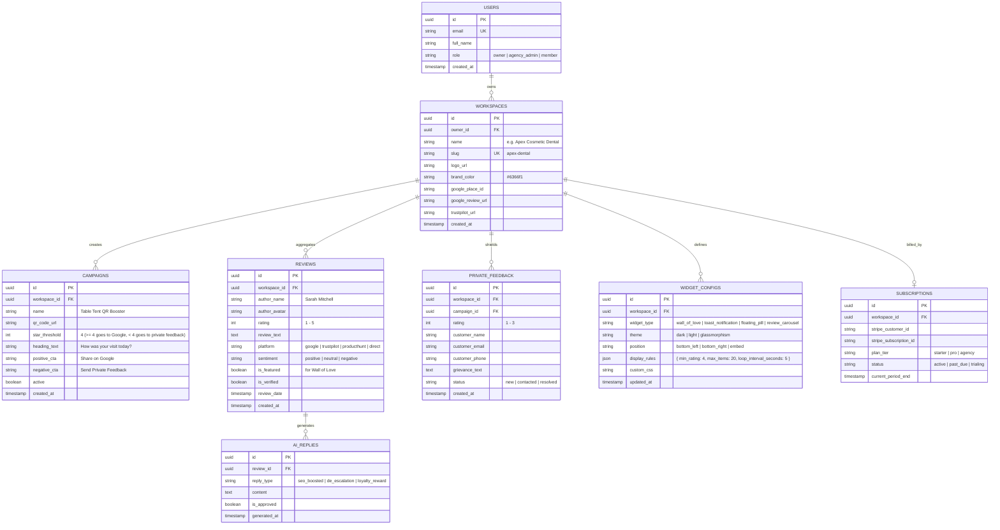

# Entity-Relationship Diagram (ERD) — TrustPulse AI

---

## Table Descriptions & Constraints

1. **`workspaces`**: Enables multi-tenancy. Agencies on the Agency Plan can create multiple workspaces for different clients (e.g. Dr. Thorne Dental, Miami Auto Care).
2. **`reviews`**: Holds all imported and captured reviews. Supports multi-platform attribution (Google, Trustpilot, Product Hunt, Direct).
3. **`private_feedback`**: Stores all 1 to 3 star shielded feedback so business owners can de-escalate directly without getting penalized on public review sites.
4. **`widget_configs`**: JSON-configurable settings for toast notifications, wall of love, and badges.
5. **`ai_replies`**: Stores PulseMind™ AI-generated response variations for quick 1-click copy to Google My Business.
